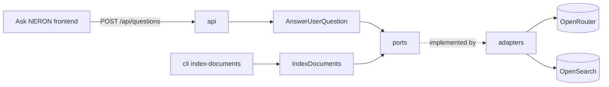

# Architecture

## Stack

- Python, managed with `uv`; FastAPI for the API, Typer for the indexation CLI.
- OpenAI SDK pointed at OpenRouter for chat and embeddings (see `integration.md`).
- OpenSearch as the vector store (see `database.md`).
- OpenTelemetry to Jaeger, displayed by Grafana (see `deployment.md`).

## How it fits together

## Key decisions

- Hexagonal: use cases depend on abstract `ports/` only; `adapters/` implement them; `api/dependencies.py` and `cli/` wire the concrete adapters.
- One `Config` dataclass (`emush_rag/config.py`) holds every tunable; only secrets and the vector store address come from the environment.
- The answer is grounded in retrieved context only: the prompt asks for "I don't know" otherwise, and for the question's language.
- With a chat history, the LLM first reformulates the question; retrieval uses the reformulation.

## Gotchas

- `Config` reads environment variables at import time (class attribute defaults), not at instantiation.
- Rate limiting is in memory, per process: it resets on restart and does not hold across several workers.
- Every use case exception becomes a 500 with the error message as `detail`.
