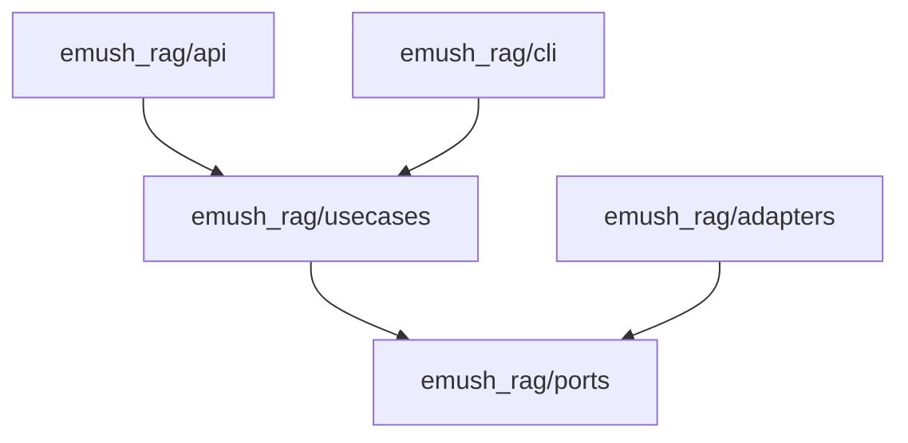

# Codebase Map

## Areas

- `emush_rag/usecases`: the two business flows, answering a question and indexing documents.
- `emush_rag/ports`: abstract interfaces (LLM client, embedder, vector store, reader, splitter, rate limiter).
- `emush_rag/adapters`: OpenRouter, OpenSearch, LangChain splitter, JSON file reader, in-memory rate limiter.
- `emush_rag/api`: FastAPI app, middleware, request models, dependency wiring, observability.
- `emush_rag/cli`: the indexation command.
- `emush_rag/prompts.py`: system and reformulation prompts.
- `data/`: a small wiki extract for local indexation; production uses a fresh scrape instead.
- `tests/`: `unit`, `integration`, `e2e`, plus `test_doubles`.
- `scripts/`, `hooks/`: production indexation script, git hooks.
- `grafana/`: provisioned datasources and dashboards baked into the Grafana image.

## Entry points

- `emush_rag/api/main.py`: the `app` served by uvicorn.
- `emush_rag/cli/index_documents.py`: the `index-documents` command.
