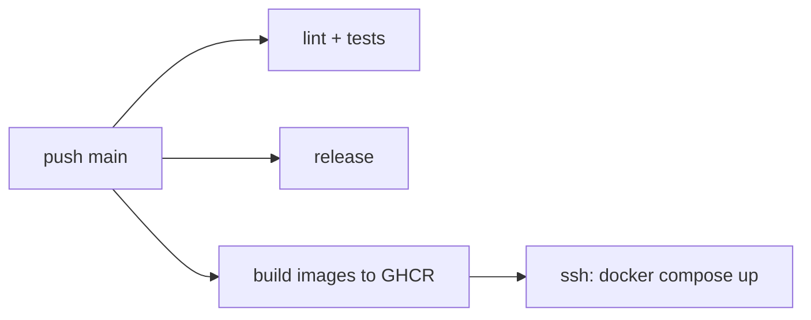

# Deployment

## Pipeline

- GitHub Actions; CI, release and deploy run on every push to `main`.
- `continuous_integration.yaml`: Ruff, Mypy, then tests with coverage.
- `create_github_release.yaml`: python-semantic-release cuts the GitHub release.
- `deploy_api.yaml`: builds the app and Grafana images to GHCR, tagged `sha-<short>` and `latest`, then deploys over SSH; also rebuilds every Monday at 5:00 to pick up base image fixes.
- `index_documents.yaml`: reindexes production every Monday at 6:00 (see `cli.md`).
- Deploy and indexation share the `deploy` concurrency group: one at a time, since a deploy recreates OpenSearch.

## Environments

- Local: `make run` (Docker Compose with watch, Traefik at `askneron.localhost`).
- Production: OVH VPS `cmnemoi.production`, configured by the `my-vps` repo (Ansible): Podman rootless under the `askneron` user, driven with `docker compose`, behind Caddy.
- Production URLs: `api.askneron.cmnemoi.com`, `grafana.askneron.cmnemoi.com`.
- `compose.prod.yml` publishes no port; the CI adds `~/compose.vps.yaml`, generated by `my-vps`, which binds ports to the server loopback. Port changes belong in `my-vps`.

## Release

- Version bumped by semantic-release from commit types, locally by the post-commit hook and in CI.
- Rollback: redeploy an older `sha-<short>` image tag; for the index, point the alias back to the previous version.

## Secrets

- `secrets.env` is encrypted with sops + age (`.sops.yaml`); `make setup-env-variables` decrypts it to `.env`, `make edit-secrets` edits it.
- CI and production secrets live in GitHub secrets and variables.

## Monitoring

- OpenTelemetry traces and metrics to Jaeger, displayed by Grafana with provisioned dashboards (`grafana/`). No alerting.
